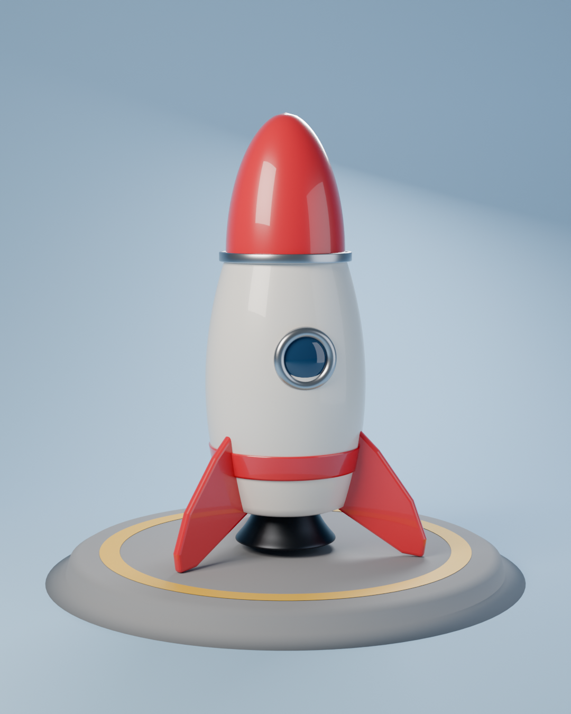

# Blender models

3D models built with Python scripts that drive Blender's API (`bpy`). Each
model is a script, so it can be regenerated, tweaked and version-controlled.



## Models

| Model | Script | Files |
|-------|--------|-------|
| Toy rocket on a launch pad | [`scripts/rocket.py`](scripts/rocket.py) | [`rocket.blend`](models/rocket.blend), [`rocket.glb`](models/rocket.glb), [`rocket.png`](renders/rocket.png) |

- **`.blend`** opens in Blender with the full scene: model, lights, camera and render settings.
- **`.glb`** is the model on its own, for game engines (Unity, Godot, Unreal), three.js or online viewers.

## Running the scripts

Blender is installed as a Python module from PyPI, so no Blender app or screen is needed. It needs Python 3.13.

```bash
python3.13 -m venv .venv
.venv/bin/pip install -r requirements.txt
.venv/bin/python scripts/rocket.py            # full render (a few minutes on CPU)
.venv/bin/python scripts/rocket.py --preview  # quick low-quality render
```

If you have the Blender app installed, the same script runs with `blender --background --python scripts/rocket.py`.
