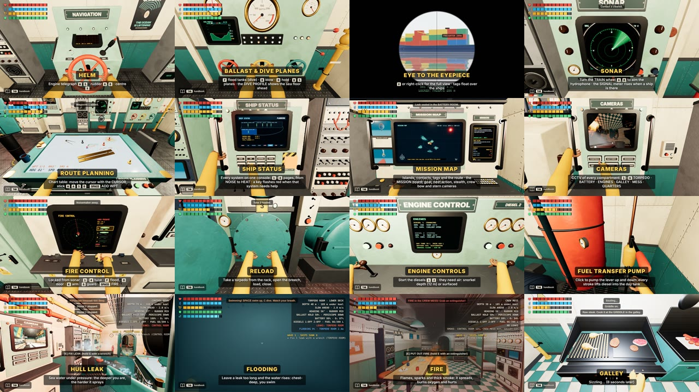

# Deepwater Crew

A co-op submarine combat game for 1–4 players that runs in the browser. Everyone crews the same
boat: steer it, dive it, hunt enemy convoys through the periscope, reload the torpedo tubes by
hand, run the diesels, fix leaks with a wrench, pump out flood water, fight fires and keep the crew fed. All 3D models come from
[`../submarine`](../submarine/README.md). They are generated by Blender scripts and loaded here as GLB files.

## Play

You need [Node.js](https://nodejs.org) 18 or newer and a desktop browser.

```bash
cd game
npm install
```

```bash
npm start
```

Then open <http://localhost:8080/game/> and pick a role.

**Co-op:** everyone opens the host's address (for example `http://192.168.1.20:8080/game/`) and types
`ws://192.168.1.20:8080` into the *Multiplayer server* box before picking a role. The first player to
join hosts the simulation. Up to 4 players can join, each seeing the others as their crew character. Any role can run any station.

## Video tour

**[media/deepwater_tour.mp4](media/deepwater_tour.mp4)** (about 5 minutes) is recorded from the real game and uses
every control on the boat: the helm and autopilot, ballast and the dive profile, tagging ships through the periscope,
listening on sonar, planning a route, the ship-status pages and general alarm, the mission wall and CCTV, aiming and
firing a torpedo, reloading a tube, the diesels, fuel, oil and coolant, the switchboard, a hull leak, flooding and
swimming, the bilge pump, a fire, smoke extract, the galley, the sick bay, the bridge and the crew handbook.
The scripts that record it are in [tools/video](tools/video/README.md).



## The boat

The boat has two decks. Stairs in the forward quarters lead down to the lower deck.

| Deck | Room | What you do there |
|---|---|---|
| Upper | **Forward quarters** | Bunks, and the **sick bay**: lie on the med bed to heal; first-aid kits in the cabinet and on the shelf. The **stairwell** goes down to the torpedo room. |
| Upper | **Control room** | **Helm**: engine telegraph, rudder and route autopilot. **Ballast panel**: flood or blow tanks, dive planes, and the DIVE PROFILE screen. **Periscope**, **sonar**, **fire control** (with an AIM stick and DECOY button), the **chart table** with its route-planning pod, the **SHIP STATUS** diagnostics console with the general alarm, the **MISSION WALL** (big mission map with the islands, the mission board, bow and stern cameras) and the **CAMERAS** console (CCTV of every compartment). Ladder to the bridge, and a hull-shock switch on the electrical cabinet. |
| Upper | **Crew mess** | Eat at the table, drink coffee for stamina, rest in a bunk, watch the outside cameras on the wall TVs. |
| Upper | **Galley** | Take raw steaks from the fridge or shelves and cook them on the griddle. Leave them too long and they burn. |
| Upper | **Engine passage** | A grated walkway with railings, over a pit full of pipework. |
| Upper | **Engine room** | Two big **diesels** in a pit, with a catwalk between them and a **DIESEL panel** for each (POWER, status screen, TALK). On the aft platform: the **engine controls**, the **fuel day tank** with its hand transfer pump, a **bilge pump**, and spare jerrycans and oil cans. |
| Lower | **Torpedo room** | Take torpedoes from the racks, open a tube's breech door, load it, close it. A **tool board** behind the workbench: every tool hangs on its painted outline (take the wrench and the extinguisher from there). A **bilge pump**. |
| Lower | **Battery room** | The **main switchboard** (breakers and the MAIN BREAKER), battery banks, a **bilge pump**, and **stores** with jerrycans and oil cans. |

Watertight doors between rooms can be closed to stop flood water and smoke spreading.
Every room has a **SMOKE EXTRACT** switch for its ventilation fans.

## Controls

**Walking:** `WASD` move · mouse look (click to capture) · `Shift` run · `E` use (hold it for repairs, refuelling and topping up oil) · `Q` drop · `F` eat or use a first-aid kit · `M` mute · `Esc` leave a station · `TAB` the crew handbook (how every station and system works)

At a station you can press the keys, or **click the buttons, keys and switches on the panel** itself. The help box folds away after a few seconds; `I` shows it again.

**Swimming** (when the water is chest deep): `Space` swim up · `C` dive · `Shift` swim faster. Watch the **BREATH** bar when your head is under water.

When you use a station the camera moves in close and you see your own hands on the controls.

| Station | Keys |
|---|---|
| Helm | `W`/`S` engine telegraph (Full Astern … Flank) · `A`/`D` rudder (steering wheel) · `X` centre · `T` autopilot along the chart route · `C` external 3D view |
| Chart table | `WASD` or drag the CURSOR stick · `Space` ADD WPT at the cursor · `Backspace` DEL WPT · `Z`/`X` or wheel zoom · `R` cursor back to the boat |
| Ship status | `1`–`8` or `Q`/`E` pages: NOISE · AIR · ENGINES · POWER · LEAKS · FLOOD · FIRE · HEAT (a page key flashes red when that system needs help) · `G` GENERAL ALARM |
| Mission map | `Z`/`X` or wheel zoom the big map · the mission board shows the goal, the next action, stealth and the crew |
| Cameras | `1`–`6` or `Q`/`E`: TORPEDO · BATTERY · ENGINES · GALLEY · MESS · QUARTERS |
| Diesel panel | `P` POWER (start / stop that diesel) · `T` TALK (report to the control room) |
| Ballast & planes | `F` flood (dive) · `B` blow (surface) · `H` hold · `W`/`S` planes rise/dive · `X` level |
| Periscope | hold the mouse button and drag, or `A`/`D`, to train the head (you turn with it) · `W`/`S` or the TILT knob · wheel or `Z`/`X` for the ZOOM knob · `1`–`8` or `Q`/`E` move the tag slider · `Space` MARK the ship in the crosshair with that tag · `C` CLEAR the tag · `V` or right-click to put your eye to the eyepiece · `R` raise/lower (only above 14 m) |
| Sonar | `A`/`D` or drag: TRAIN wheel (aim the hydrophone and listen; the SIGNAL meter rises when something is there) · `W`/`S` GAIN · `L` LOCK what you hear · `P` active ping (shows everything, but they hear you) · `N` next contact |
| Fire control | `1`–`4` or `Q`/`E` (TUBE −/+) tube · `F` flood · `O` outer door · `K` arm key · `G` guard · `Space` FIRE · `A`/`D` or drag: AIM stick (torpedo course when nothing is locked) · `N` DECOY (noisemaker) |
| Tube breech | `E` open/close the breech · carry a torpedo here to load |
| Griddle | `P` power · `E` put raw food on / take cooked food off |
| Engine controls | `1` / `2` start or stop diesel 1 / 2 |
| Fuel transfer pump | **click** (or `W`/`S`) to work the lever up and down: every stroke lifts diesel into the day tank |
| Bilge pump | **click** (or `W`/`S`) to work the handle up and down: every stroke lifts water out of that room |
| Main switchboard | `1`–`8` close or open a breaker · `M`, `Space` or click for the MAIN BREAKER |
| Bridge (ladder, when surfaced) | mouse to look · right-click for binoculars |

## The sea

The patrol area has five **islands** (with a lighthouse on Sentinel Isle) and a shoal. They show on every chart and
through the periscope. Ships steer round them; the boat runs aground on a shore or stops against a rock wall if it
tries to sail through, and torpedoes blow up on the rocks. Compartments have a **temperature**: running diesels and
fires heat them, the ventilation fans cool them, and a hot room tires you out.

## How a fight goes

1. **Find them.** Dive to periscope depth (14 m or shallower), raise the periscope and look around,
   or listen on sonar. Contacts appear on the chart and nav screens.
2. **Lock on.** Turn the periscope until a ship is in the crosshair: the TARGET IDENTIFICATION screen under the
   eyepiece shows its class, outline, range and bearing. Pick a tag number on the slider and press MARK; a numbered
   tag floats over that ship for the whole crew. Or cycle sonar contacts with `N`. Fire control shows the bearing and range.
3. **Fire.** Choose a loaded tube, flood it, open the outer door, turn the arm key, lift the guard and press FIRE.
   Torpedoes steer towards the locked target.
4. **Reload.** The loader carries a spare torpedo from the racks to an open breech. Six spares, and you can see the racks empty.
5. **Survive.** Frigates hunt anything noisy. Speed, a raised periscope, blowing tanks and sonar pings all
   make noise. They drop depth charges, and shell you if you surface. Enemy subs fire torpedoes,
   so turn hard and launch a noisemaker. Below 60 m a **giant squid** can grab the hull: use the HULL SHOCK switch or surface to shake it off.
   **Sharks** ram the hull in the shallows.
6. **Repair.** Every hit tears leaks in the hull. Water jets in at the speed the sea pressure gives it, so the
   deeper you are the harder and further it shoots; the jet breaks into droplets, runs down the wall and splashes
   where it lands, and once the hole is under water it bubbles instead. Grab a wrench and
   hold `E` on a leak until it's sealed.
7. **Pump.** Leave a leak too long and the water rises. It runs through open doors, pours down the stairwell to
   the lower deck and fills the engine pits. Once it is chest deep you have to swim. The electric pumps only
   trickle (and stop with the power), so work the **hand bilge pumps**: click the handle up and down.
   Close doors to keep the water in one place. If too much of the boat floods, she sinks.
8. **Fight fires.** Hits can start fires. They spread, burn oxygen and fill the room with smoke. Thick smoke
   blinds you and hurts. Grab an extinguisher from the bulkheads and hold `E` at the flames. Then switch on
   that room's **SMOKE EXTRACT** fans (they need power) to clear the air.
9. **Keep the power on.** Big hits trip the breakers. Go down to the battery room, close the tripped breakers
   on the main switchboard, then throw the MAIN BREAKER.
10. **Run the diesels.** The motors drain the battery. To recharge, rise to snorkel depth (12 m or shallower) or
    surface, and start the diesels at the engine controls. They burn fuel from the **day tank**: pump more up from
    the main bunkers with the transfer pump, or pour in a jerrycan. They need oil (top up with an oil can at the
    engine's filler) and coolant. If a coolant valve shakes shut the engine overheats, so open it. An **injector
    fault** makes it run rough and smoky, and you fix that with a wrench at the injectors. Running diesels at
    snorkel depth also freshen the air.
11. **Stay alive.** Drowning, smoke and flames hurt. Lie on the med bed in the sick bay or use a first-aid kit.
    If you black out, your crewmates carry you to the sick bay.
12. **Eat.** Hunger slowly drains. A hungry sailor can't regain stamina and walks slowly, so the cook keeps everyone fed.

Sink a whole convoy and the next, bigger wave arrives.

## Code

| File | What it does |
|---|---|
| `src/sim.js` | The simulation: sub physics, enemies, creatures, torpedoes, depth charges, damage, leaks, flooding by volume, smoke, fires, diesels, fuel, switchboard, noise, route and autopilot, general alarm. No rendering. |
| `src/consoles.js` | Draws the console screens: SHIP STATUS pages with a two-deck plan, the DIVE PROFILE, the fire-control target scope, the sonar compass, the MISSION MAP and board, the diesel panels, islands and the route on the charts. |
| `src/nav.js` | Walkable areas of the two decks (floors, stairs, catwalks, the aft platform, doors), built from `submarine/models/nav.json`. |
| `src/particles.js` | GPU particles with per-particle size, colour and alpha, used for flames, embers, smoke, splashes and diesel exhaust. |
| `src/exterior.js` | The outside world: sky, animated ocean, underwater fog, ships, creature swimming, explosions, smoke; periscope, bridge and chase cameras. |
| `src/interior.js` | Loads the interior model. Finds stations, doors, cameras and hand targets from the glTF extras. Handles colliders, live screens, leaks, flood water, smoke, fire, machinery animation, the lamp light pool and the alarm light. |
| `src/game.js` | Player, stations, first-person hands (two-bone IK with finger poses), interactions, HUD and the main loop. |
| `src/sound.js` | Synthesised audio. No sound files needed. |
| `src/net.js`, `server.js` | Co-op: a static file server plus a WebSocket relay. The first player hosts the simulation. |

Run `npm test` for the headless checks: 29 simulation tests (diving, firing, aimed torpedoes, the route autopilot, noise, islands and grounding, heat, the hydrophone, reloading, leaks, flooding, doors, the stairwell, bilge pumps, diesels, fuel, smoke, vents, the switchboard, squid, crush depth, battery) and 8 navigation tests (stairs, doors, catwalks, swimming). For testing, URL parameters skip the menu: `?role=navigator`, `&station=helm`, and `&test=leaks|flood|fire|engines|squid|convoy|surface|deep`.
