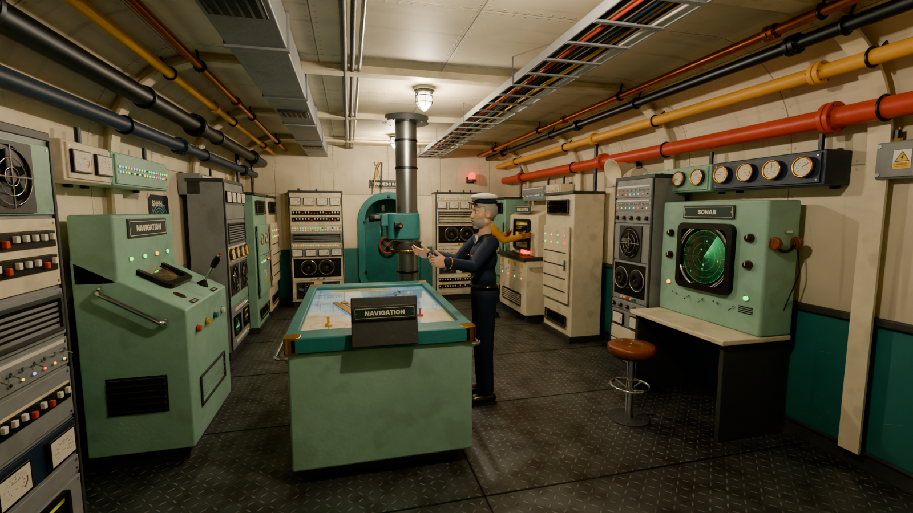
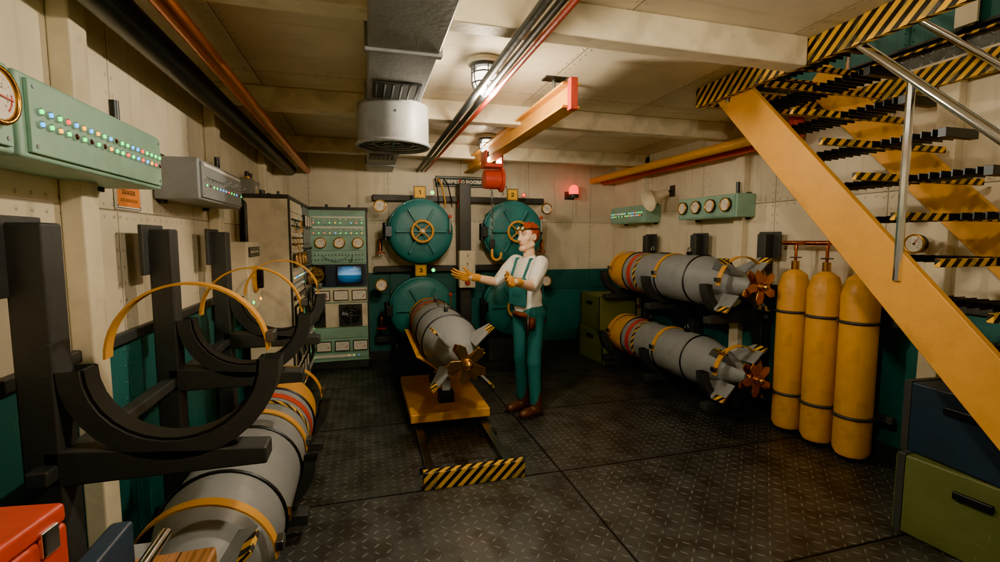
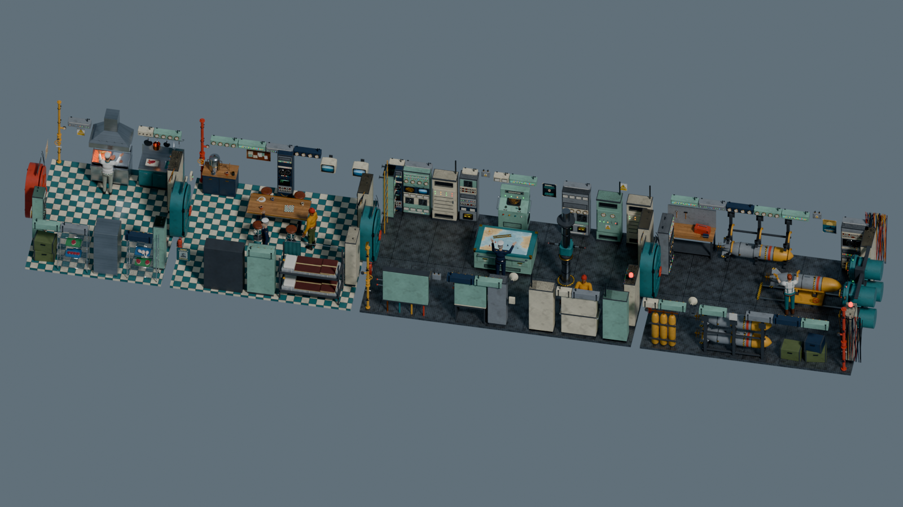

# Submarine: 4-player co-op crew game (3D assets)

An original, stylised submarine interior for a co-op game where four players crew one boat.
Every model, texture and character is generated from Python scripts that drive Blender, so
the whole set can be rebuilt, restyled or extended from code.



| | |
|---|---|
|  |  |
|  |  |
|  |  |


## The boat

Four compartments joined by watertight doors, bow at `x = 0`, stern towards `+X`
(port = `+Y`, starboard = `-Y`). One unit = 1 metre.

```
 bow                                                                                   stern
 ┌──────────────────┬───┬──────────────────────────┬───┬────────────────┬───┬────────────┬───┐
 │ TORPEDO ROOM     │ D │ CONTROL ROOM             │ D │ CREW MESS      │ D │ GALLEY     │ X │
 │ 4 tubes (2x2)    │ o │ periscope · chart table  │ o │ table, stools  │ o │ griddle    │ e │
 │ loading cradle   │ o │ nav console · fire ctrl  │ o │ bunks, lockers │ o │ hood, sink │ n │
 │ racks, hoist     │ r │ sonar · ballast panel    │ r │ coffee, TVs    │ r │ fridge     │ g │
 │                  │   │ ladder + escape hatch    │   │                │   │ shelves    │ . │
 └──────────────────┴───┴──────────────────────────┴───┴────────────────┴───┴────────────┴───┘
 x: 0              7.0 7.3                       16.3 16.6           22.6 22.9        27.4 27.7
```

Interior cross-section: 5 m wide, 2.9 m to the ceiling. Doorways are 0.9 × 1.8 m with a 12 cm sill.

### The four roles

| Player | Station(s) | Interactive parts on the model |
|---|---|---|
| **Navigator** | Chart table, nav console, ballast panel | joystick, zoom dial, buttons, map markers, ruler and dividers, BLOW/VENT/FLOOD wheels, trim levers, depth gauge needle |
| **Weapons officer** | Fire control, periscope, sonar | 4 tube-select toggles, ARM key, guarded FIRE button (flip guard), handset; periscope head trains 360°, fold-out handles, MARK/ZOOM buttons; sonar knobs and headphones |
| **Torpedo loader** | Torpedo room | 4 breech doors (hinged), locking wheels, latches, flood valves; loading cradle (carriage slides, tray lifts to the upper/lower tubes); chain hoist (trolley slides, hook lowers); torpedoes are carryable with spinning propellers |
| **Cook** | Galley | griddle power button and knobs, cupboard doors, 4 cook slots; food in raw and cooked versions (steak, drumstick, patty); fridge doors, taps, knife; coffee urn tap |

## Folder layout

```
submarine/
  scripts/              all the code (see "Rebuilding")
    build.py            builds everything below
    manifest.py         writes ASSETS.md and models/manifest.json
    sublib/             textures, materials, props, rooms, crew, exterior, rendering
  textures/             generated PNG textures (walls, floors, screens, signs, posters, food…)
  models/
    Submarine_Interior.glb   the whole interior in one file
    Submarine_Interior.blend the Blender scene (open in Blender 4.2+ / 5.x)
    rooms/              one GLB per compartment (they snap together; shared world coordinates)
    props/              every prop on its own, origin at its base (73 props)
    characters/         4 rigged crew members (T-pose)
    exterior/           our submarine's hull, an enemy frigate and a cargo freighter
    manifest.json       machine-readable list of props, moving parts and interaction points
  renders/              the images above, plus renders/props/ (one preview per prop)
  ASSETS.md             human-readable asset list (generated)
```

## Using the models in a game engine

The GLB files load directly into **Godot 4** (drag into the project), **Unity** (via the glTFast
package) and **Unreal Engine 5** (glTF importer). They use metre units and Y-up after export.

Conventions the game code can rely on:

- **Moving parts are separate nodes**, with their origin on the hinge or axis:
  `WatertightDoor_Leaf`, `TorpedoTubes_Door1`, `FireControl_FireGuard`, `Periscope_Head`,
  `NavConsole_Joystick`, `Griddle_PowerButton` and so on. To open a door, rotate its node.
- **Custom properties are exported as glTF `extras`.** Godot puts them in node metadata;
  Unity and Unreal expose them through their glTF importers. For example:
  - `interact`: what the part does (`door`, `button`, `toggle`, `valve_wheel`, `joystick`, `fire`, `pickup`, `carry`…)
  - `rotate_axis` / `translate_axis` plus `min_deg`/`max_deg` or `min`/`max`: allowed motion (Blender axes; glTF converts Z-up to Y-up)
  - `tube`: tube number (1–4), `item`: food or tool type, `cook_state`: `raw` or `cooked`
- **Interaction points** are empty nodes named `*_INTERACT_<what>` (for example `NavConsole_INTERACT_operate`,
  `TorpedoTubes_INTERACT_tube3`, `Griddle_INTERACT_cook_slot2`). They mark where a player
  stands, or where an item snaps into place.
- **Player spawn points**: `SPAWN_Player1` … `SPAWN_Player4` in the control room.
- **Lights** are included as point or spot lights (glTF punctual lights). The red `AlarmBeacon`
  has a `Reflector` node you can spin when the boat goes to battle stations.
- **Screens** use emissive materials named `screen_*` (`screen_chart`, `screen_sonar`,
  `screen_nav_scope`, `screen_fire_control`, `screen_target_id`, `screen_cam_fwd`, …).
  Swap their texture for a render texture at runtime to make them live.
- **Collision**: none is included yet. Use the engine's "generate collision" option on
  `*_Shell_Floor`, `*_Shell_Body` (walls and ceiling) and the bulkheads, and simple box colliders on props.

### Crew characters

`models/characters/Crew_*.glb` each contain one skinned mesh and a 19-bone humanoid skeleton:
Hips, Spine, Chest, Neck, Head, plus Shoulder, UpperArm, LowerArm and Hand, and UpperLeg, LowerLeg and Foot, each with `.L`/`.R`.
They are built in T-pose facing -Y, so animation libraries such as Mixamo can be retargeted onto them.
The meshes are rigidly skinned: each body part follows exactly one bone, like a toy figure,
which suits the chunky style. No animations are included yet.

## Rebuilding

Blender runs as a Python module (`bpy` from PyPI, Python 3.13). No Blender window is needed.

```bash
python3.13 -m venv .venv
.venv/bin/pip install bpy==5.3.0 pillow
.venv/bin/python submarine/scripts/build.py --sheet
.venv/bin/python submarine/scripts/manifest.py
```

`build.py` options: `--quick` (fast low-quality renders), `--no-render` (models only),
`--sheet` (per-prop preview images), `--retex` (regenerate all textures), `--shot=<name>`
(render one shot only: `control_room`, `torpedo_room`, `crew_mess`, `galley`, `cutaway`, `exterior`).
A full build takes roughly 20–25 minutes on a 4-core CPU, almost all of it rendering. The models alone take about a minute.

Where to change things:

| To change… | Edit |
|---|---|
| Colours, wear, posters, screen images, signs | `sublib/tex.py` (then build with `--retex`) |
| Material colour, roughness and so on | `MATLIB` in `sublib/core.py` |
| A prop's shape | `sublib/props_*.py` (one function per prop) |
| Where things go in the rooms, room sizes | `sublib/level.py`, `sublib/shell.py` |
| The crew | `CREW` in `sublib/crew.py` |
| Ships and the outside of the sub | `sublib/exterior.py` |

## Known gaps and next steps

- Collision meshes and LODs aren't included yet.
- The escape-trunk hatch in the control-room ceiling is decorative. The ceiling has no hole.
- Characters have a skeleton but no animations.
- Exterior: the ocean and sky in `exterior.png` are render-only. The game engine provides its own water.
