# Submarine: 4-player co-op crew game (3D assets)

An original submarine interior for a co-op game where four players crew one boat.
Every model, texture and character is generated from Python scripts that drive Blender, so
the whole set can be rebuilt, restyled or extended from code.

**These assets already run in a playable browser game: see [`../game`](../game/README.md).**


| | |
|---|---|
| 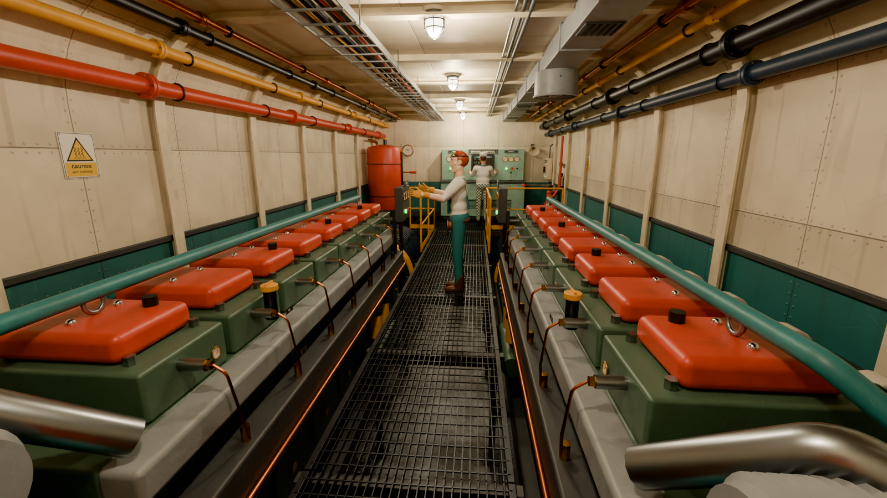 | 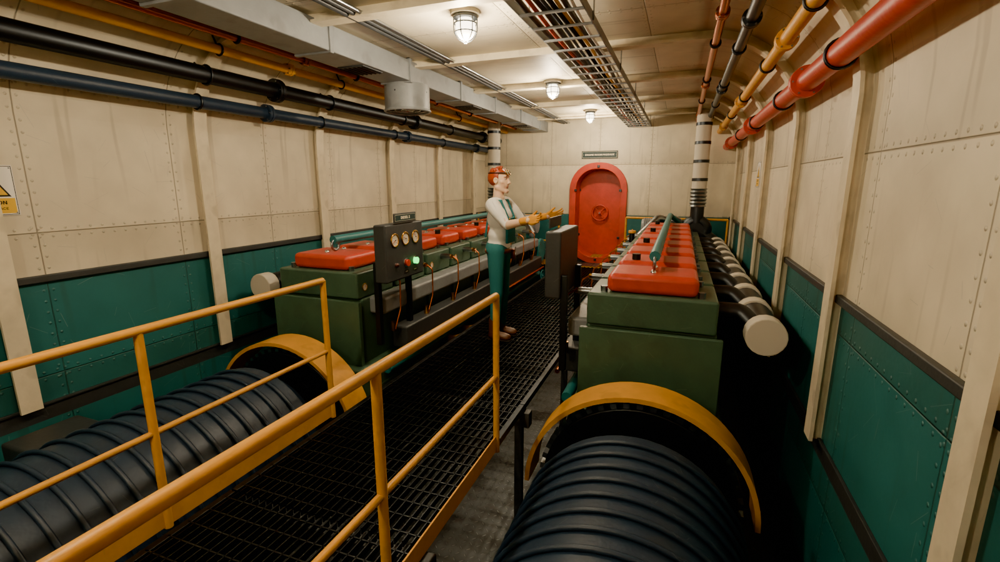 |
|  | 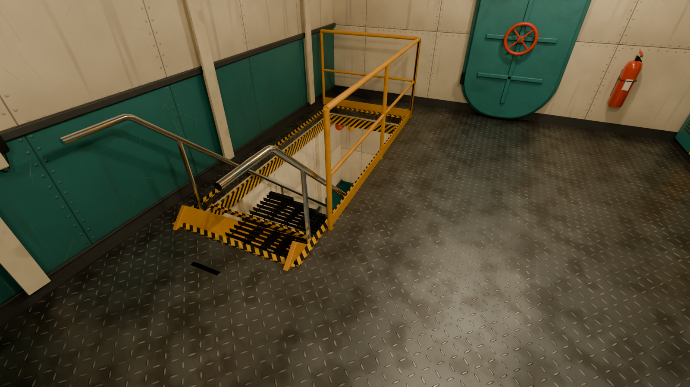 |
| 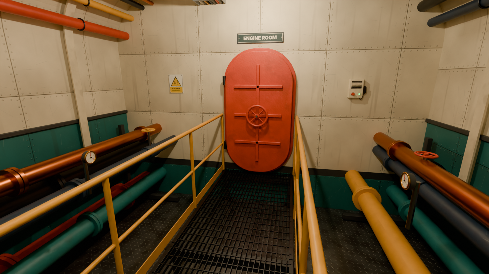 | 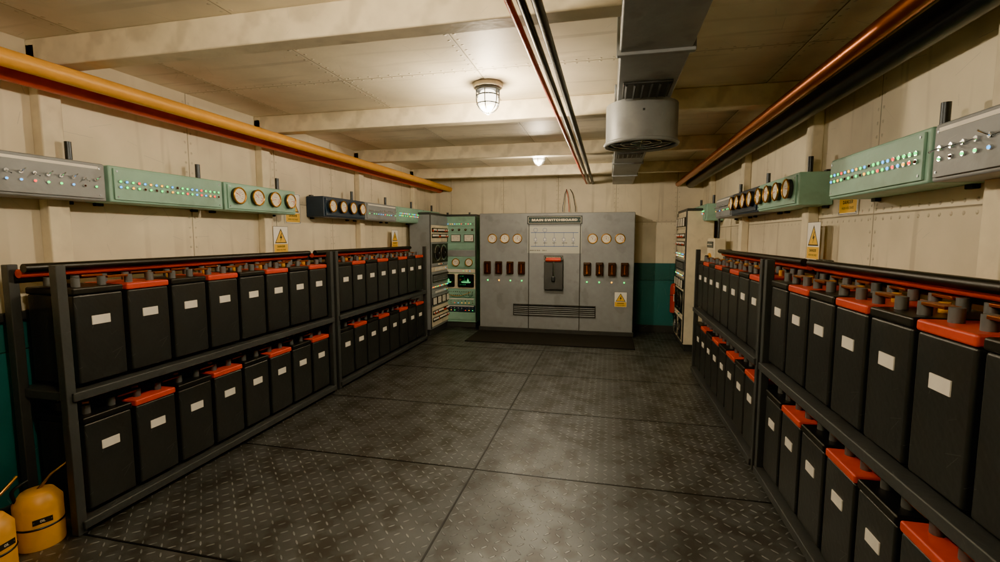 |
| 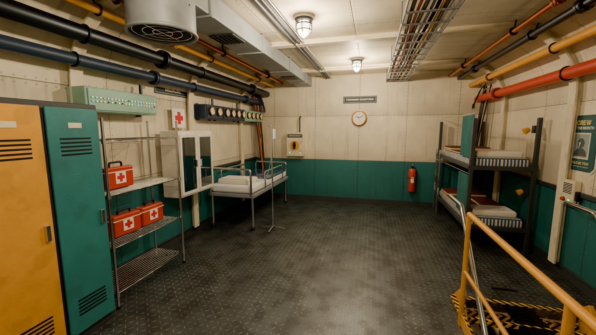 | 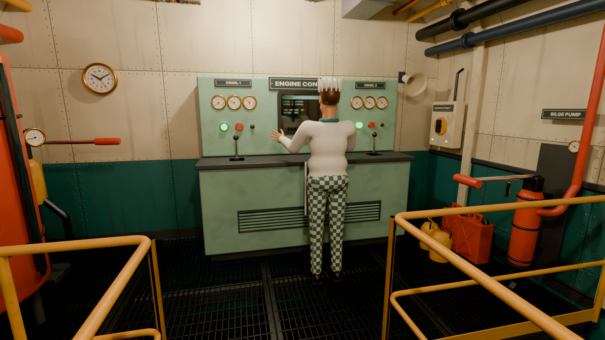 |
| 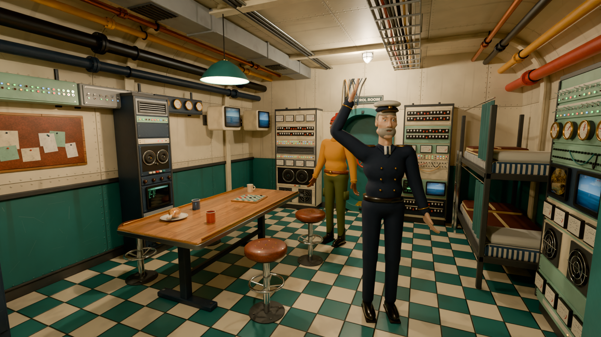 | 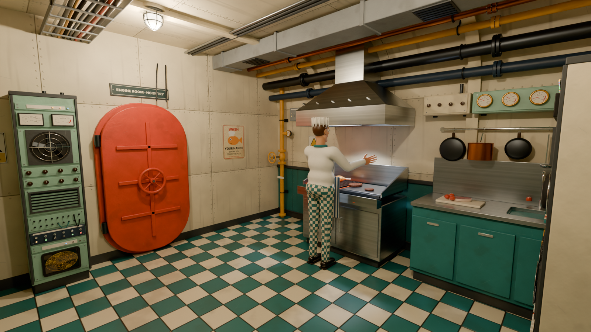 |
| 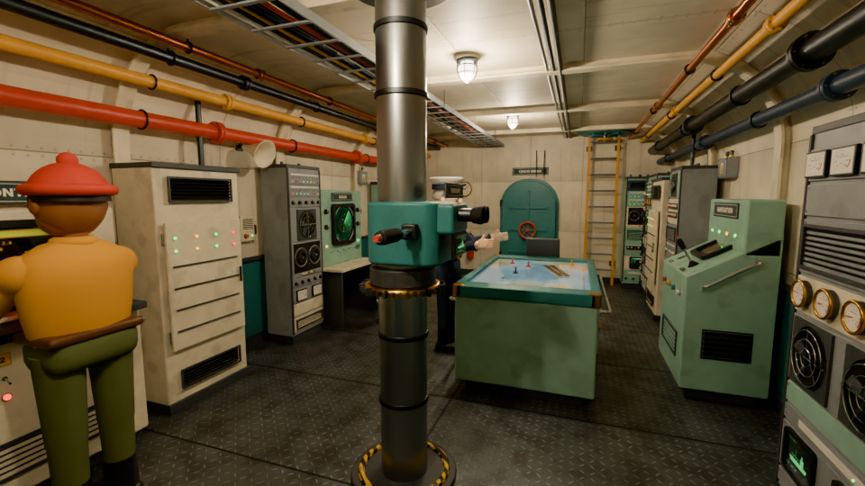 | 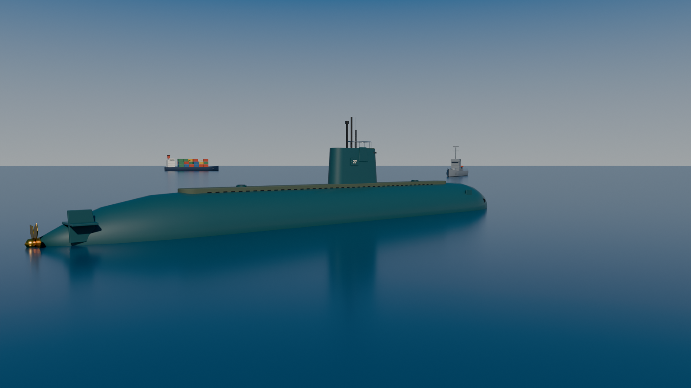 |
|  | 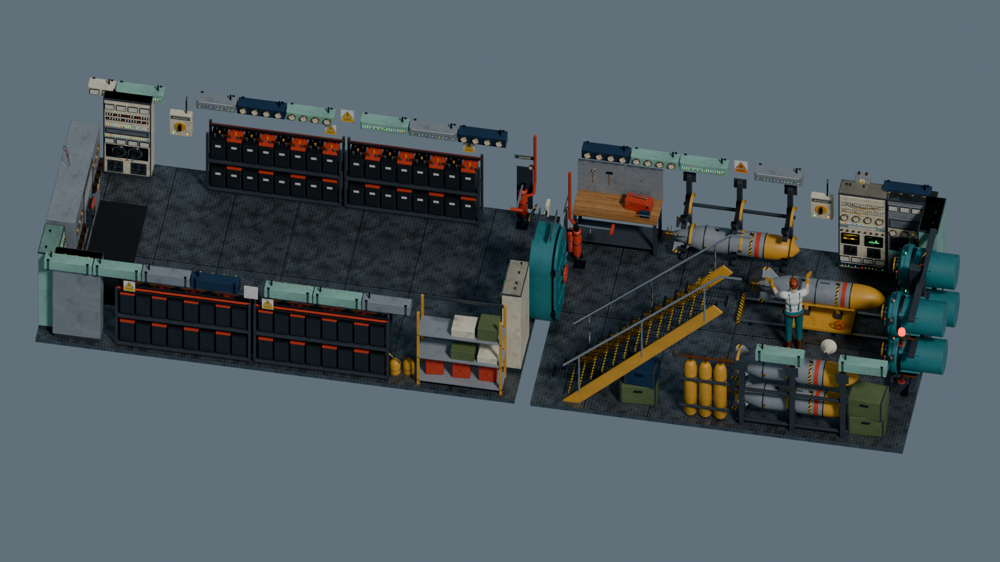 |

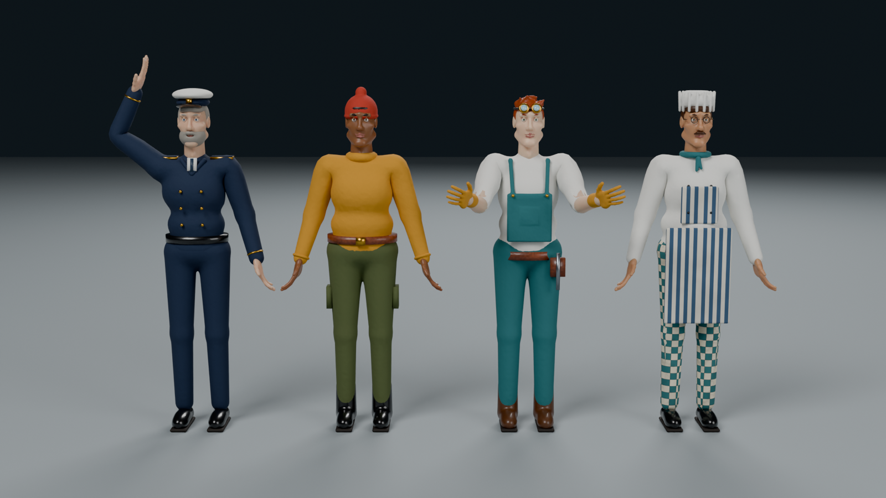

## The boat

Eight compartments on two decks, joined by watertight doors and a stairwell. The bow is at `x = 0` and the stern
towards `+X` (port = `+Y`, starboard = `-Y`). The upper deck floor is at `z = 0` and the lower deck floor at `z = -2.9`.
One unit is 1 metre.

```
 UPPER DECK (floor z = 0, deckhead 2.9)
 bow                                                                                                        stern
 ┌────────────────┬─┬──────────────────────┬─┬──────────────┬─┬───────────┬─┬───────────┬─┬───────────────────────┐
 │ FWD QUARTERS   │D│ CONTROL ROOM         │D│ CREW MESS    │D│ GALLEY    │D│ PASSAGE   │D│ ENGINE ROOM           │
 │ bunks          │o│ periscope · chart    │o│ table, bunks │o│ griddle   │o│ grated    │o│ 2 diesels in a pit,   │
 │ sick bay       │o│ nav console · fire   │o│ coffee, TVs  │o│ fridge    │o│ walkway   │o│ catwalk, motors,      │
 │ STAIRWELL ▼    │r│ sonar · ballast      │r│              │r│ shelves   │r│ over pipes│r│ aft control platform  │
 └────────────────┴─┴──────────────────────┴─┴──────────────┴─┴───────────┴─┴───────────┴─┴───────────────────────┘
 x: 0           7.0 7.3                 16.3 16.6         22.6 22.9     27.4 27.7     31.7 32.0                 44.0

 LOWER DECK (floor z = -2.9, deckhead -0.12)
 ┌────────────────┬─┬──────────────────────┐
 │ TORPEDO ROOM   │D│ BATTERY ROOM         │
 │ 4 tubes, racks │o│ MAIN SWITCHBOARD     │
 │ stairs ▲       │o│ battery banks, stores│
 │ bilge pump     │r│ bilge pump           │
 └────────────────┴─┴──────────────────────┘
 x: 0           7.0 7.3                 16.3
```

Upper cross-section: 5 m wide, 2.9 m to the deckhead. Lower deck: 4.8 m wide, 2.78 m high. Doorways are
0.9 × 1.8 m with a 12 cm sill. The engine pit is 1.2 m deep (x 32.6–44.0) and the passage pit 0.6 m.

### Ship's systems on the models

| System | Models | Moving parts / interaction points |
|---|---|---|
| **Diesels** | `DieselEngineP/S`: 8 cylinders, red rocker covers, copper injector lines, lagged exhaust manifold, turbocharger, bellows uptake, flywheel guard, local gauge panel. `MotorP/S`: motor-generators. `ShaftLine` | `Flywheel` (spins), `CoolantValve`, `OilFiller`, `StartButton`, `StopButton`, `FaultLamp`, gauge needles, `INTERACT_fault_point` (injectors), `CAM_panel` |
| **Engine controls** | `EngineConsole` with live `screen_engine` | `Start1/2`, `Stop1/2`, `Throttle1/2`, `Fault1/2` lamps, RPM / temp / oil needles, `ChargeAmmeter` |
| **Fuel** | `FuelStation` (day tank with sight glass, filler, hand transfer pump), `Jerrycan`, `OilCan`, `StoresShelf` | `PumpLever` (rocks ±28°), `FuelLevel` (scale Z = fuel fraction), `FillerCap` |
| **Bilge** | `BilgePump` ×3 (torpedo room, battery room, engine room) | `Lever` (rocks ±25°), hand targets on the handle |
| **Smoke extract** | `VentPanel` ×8 (one per room), `DuctFan` ×8 | `FanSwitch`, `Fan` (spins) |
| **Electrics** | `MainSwitchboard` (mimic bus, meters, 8 knife breakers, MAIN BREAKER), `BatteryBank` ×4 | `BreakerL1–4`, `BreakerR1–4`, `MainBreaker` |
| **Medical** | `MedicalCabinet`, `MedBed` (rails, IV stand), `FirstAidKit` | cabinet `DoorL/R`, `INTERACT_lie`, `SPAWN_Medical` |
| **Walkways** | `Stairs` (grated treads, handrails), `PassageCatwalk`, `EngineCatwalk`, `AftPlatform`, railings, `PipeBankA/B` | `INTERACT_bottom` / `INTERACT_top` on the stairs |

`models/nav.json` describes the walkable areas (decks, door openings, the stairs, catwalks, the
platform, the stairwell opening and the pits) so a game can build its navigation without collision meshes.

### The four roles

| Player | Station(s) | Interactive parts on the model |
|---|---|---|
| **Navigator** | Chart table, nav console, ballast panel, ship status console | joystick, zoom dial, buttons, map markers, ruler and dividers, a route-planning pod on the chart table (cursor stick, ADD/DEL WPT keys, zoom knob), BLOW/VENT/FLOOD wheels, trim levers, depth gauge needle, DIVE PROFILE screen; SHIP STATUS console with eight back-lit page keys, a guarded GENERAL ALARM button and side handles |
| **Weapons officer** | Fire control, periscope, sonar | 4 tube-select toggles, ARM key, guarded FIRE button (flip guard), AIM stick, DECOY button, handset; periscope head trains 360° with a twin-ocular eyepiece in a rubber hood, bearing compass, TARGET IDENTIFICATION screen, MARK/CLEAR buttons, 1–8 tag slider, knurled ZOOM and TILT knobs and fold-down training handles on angled brackets; sonar knobs and headphones |
| **Torpedo loader** | Torpedo room | 4 breech doors (hinged), locking wheels, latches, flood valves; loading cradle (carriage slides, tray lifts to the upper/lower tubes); chain hoist (trolley slides, hook lowers); torpedoes are carryable with spinning propellers |
| **Cook** | Galley | griddle power button and knobs, cupboard doors, 4 cook slots; food in raw and cooked versions (steak, drumstick, patty); fridge doors, taps, knife; coffee urn tap |

## Folder layout

```
submarine/
  scripts/              all the code (see "Rebuilding")
    build.py            builds everything below
    manifest.py         writes ASSETS.md and models/manifest.json
    sublib/             textures, materials, props, rooms, crew, exterior, rendering
  textures/             generated PNG textures (walls, floors, screens, signs, posters, food…)
  models/
    Submarine_Interior.glb   the whole interior in one file
    Submarine_Interior.blend the Blender scene (open in Blender 4.2+ / 5.x)
    rooms/              one GLB per compartment (they snap together; shared world coordinates)
    props/              every prop on its own, origin at its base (about 100 props)
    characters/         4 rigged crew members (Crew_*.glb, T-pose) + first-person arms (FPArms_*.glb)
    exterior/           our sub, enemy sub, frigate, freighter, giant squid and shark (creatures are rigged)
    manifest.json       machine-readable list of props, moving parts and interaction points
    nav.json            walkable areas of both decks for game navigation
  renders/              the images above, plus renders/props/ (one preview per prop)
  ASSETS.md             human-readable asset list (generated)
```

## Using the models in a game engine

The GLB files load directly into **Godot 4** (drag into the project), **Unity** (via the glTFast
package) and **Unreal Engine 5** (glTF importer). They use metre units and Y-up after export.

Conventions the game code can rely on:

- **Moving parts are separate nodes**, with their origin on the hinge or axis:
  `WatertightDoor_Leaf`, `TorpedoTubes_Door1`, `FireControl_FireGuard`, `Periscope_Head`,
  `NavConsole_Joystick`, `Griddle_PowerButton` and so on. To open a door, rotate its node.
- **Custom properties are exported as glTF `extras`.** Godot puts them in node metadata;
  Unity and Unreal expose them through their glTF importers. For example:
  - `interact`: what the part does (`door`, `button`, `toggle`, `valve_wheel`, `joystick`, `fire`, `pickup`, `carry`…)
  - `rotate_axis` / `translate_axis` plus `min_deg`/`max_deg` or `min`/`max`: allowed motion (Blender axes; glTF converts Z-up to Y-up)
  - `tube`: tube number (1–4), `item`: food or tool type, `cook_state`: `raw` or `cooked`
- **Station cameras**: every station has a glTF camera named `*_CAM_use` (the torpedo tubes have
  `TorpedoTubes_CAM_tube1..4`). When a player uses the station, move the view to it.
- **Hand targets**: empty nodes named `*_HAND_L` / `*_HAND_R` sit on the controls (joystick, dials,
  FIRE button, valve wheels, periscope handles). Their extras give `hand_pose` (`grip`, `bar` for a sideways handle, `knob`, `pinch`,
  `press`, `palm`) and the `control` they belong to. Drive the first-person arms there with two-bone IK.
- **Interaction points** are empty nodes named `*_INTERACT_<what>` (for example `NavConsole_INTERACT_operate`,
  `TorpedoTubes_INTERACT_tube3`, `Griddle_INTERACT_cook_slot2`). They mark where a player
  stands, or where an item snaps into place.
- **Player spawn points**: `SPAWN_Player1` … `SPAWN_Player4` in the control room, and `SPAWN_Medical` in the sick bay.
- **Lights** are included as point or spot lights (glTF punctual lights). The red `AlarmBeacon`
  has a `Reflector` node you can spin when the boat goes to battle stations.
- **Screens** use emissive materials named `screen_*` (`screen_chart`, `screen_sonar`,
  `screen_nav_scope`, `screen_fire_control`, `screen_target_id`, `screen_cam_fwd`, …).
  Swap their texture for a render texture at runtime to make them live.
- **Collision**: none is included yet. Use the engine's "generate collision" option on
  `*_Shell_Floor`, `*_Shell_Body` (walls and ceiling) and the bulkheads, and simple box colliders on props.

### Crew characters

Four crew members with realistic proportions: the navigator (captain's uniform, beard), the
weapons officer (knit sweater, beanie), the torpedo loader (overalls, gloves, goggles) and the
cook (chef's jacket, striped apron, glasses). They're sculpted with signed-distance shapes:
faces with eyelids, iris textures, lips, nose and ears; five-finger hands with fingernails;
clothing shaped to the body. Skin uses subsurface scattering. Each has about 35–40k triangles.

- `Crew_*.glb`: one skinned mesh on a **51-bone** humanoid rig. That's Hips, Spine, Chest, Neck and Head;
  Shoulder, UpperArm, LowerArm and Hand; Thumb, Index, Middle, Ring and Pinky 1–3; and UpperLeg, LowerLeg, Foot and Toes, all with `.L`/`.R`.
  T-pose, facing -Y, ready for retargeted animations.
- `FPArms_*.glb`: first-person arms (hands and sleeves) on the same skeleton. Parent them to the
  game camera (the eye sits at `eye_offset` in the extras) and IK the hands onto the `HAND_*` targets.

### Wall machinery

Every free stretch of wall and bulkhead is filled with full-height equipment racks (28 variants)
built from random modules: gauge rows, switch banks, LED strips, reel-to-reel recorders, small
screens, breaker grids, patch panels with cables, fans, meters. Shallow instrument boxes sit above
the lower consoles, a ventilation duct runs along each ceiling, and cable looms run into the overhead.
This is set dressing only. The racks are exported as `props/Rack_*.glb` and `props/WallBox_*.glb`.

### Combat and repair props

`exterior/EnemySubmarine.glb`, `exterior/GiantSquid.glb` (bones `Arm1_1…`, `TentacleL_1…` for
procedural swimming), `exterior/Shark.glb` (6-bone spine), and `props/Wrench.glb`,
`props/HullCrack.glb` (torn plate where water sprays in), `props/HullPatch.glb` (bolted repair).

## Rebuilding

Blender runs as a Python module (`bpy` from PyPI, Python 3.13). No Blender window is needed.

```bash
python3.13 -m venv .venv
.venv/bin/pip install bpy==5.3.0 pillow scikit-image
.venv/bin/python submarine/scripts/build.py --sheet
.venv/bin/python submarine/scripts/manifest.py
```

`build.py` options: `--quick` (fast low-quality renders), `--no-render` (models only),
`--sheet` (per-prop preview images), `--retex` (regenerate all textures), `--shot=<name>`
(render one shot only: `control_room`, `control_room_fwd`, `torpedo_room`, `stairwell`, `fwd_quarters`, `battery_room`,
`passageway`, `engine_room`, `engine_aft`, `engine_platform`, `crew_mess`, `galley`, `cutaway`, `cutaway_lower`, `exterior`).
A full build takes roughly 20–25 minutes on a 4-core CPU, almost all of it rendering. The models alone take about a minute.

Where to change things:

| To change… | Edit |
|---|---|
| Colours, wear, posters, screen images, signs | `sublib/tex.py` (then build with `--retex`) |
| Material colour, roughness and so on | `MATLIB` in `sublib/core.py` |
| A prop's shape | `sublib/props_*.py` (one function per prop) |
| Where things go in the rooms, room sizes, decks | `sublib/level.py`, `sublib/shell.py` |
| Diesels, motors, fuel station, engine console | `sublib/props_engine.py` |
| Bilge pump, vents, batteries, switchboard, medical | `sublib/props_systems.py` |
| Stairs, catwalks, gratings, railings, pipe banks | `sublib/props_walkway.py` |
| The crew (faces, outfits, builds) | `CREW` in `sublib/humans.py` |
| Wall machinery modules | `sublib/props_machinery.py` |
| Ships and the outside of the sub | `sublib/exterior.py` |
| Creatures, enemy sub, wrench | `sublib/creatures.py` |

## Known gaps and next steps

- Collision meshes and LODs aren't included yet (`nav.json` covers walking).
- The escape-trunk hatch in the control-room ceiling is decorative. The ceiling has no hole.
- Characters have a full skeleton but no baked animations. The game poses arms and fingers procedurally.
- Exterior: the ocean and sky in `exterior.png` are render-only. The game engine provides its own water.
